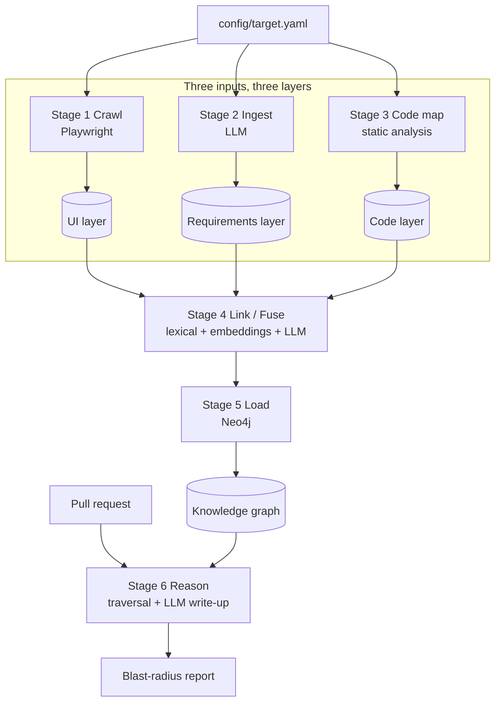

# Design Document — Blast Radius Engine

A tri-layer knowledge graph that connects product intent (requirements), the running UI, and the code behind it, and uses that graph to report the blast radius of a real pull request in language a QA lead can read.

Target application: **Excalidraw** (`excalidraw.com`, repo `excalidraw/excalidraw`). The choice is part of the signal: no authentication, instant crawl, and descriptively named React components, so the time budget goes to the graph and the reasoning rather than to auth flows or a giant monorepo.

---

## 1. The bet, stated up front

Sixteen hours is not enough to do crawl, ingest, graph, and reason to equal depth. The assignment rewards choosing. Here is the choice, made deliberately and defended throughout:

- **Deep:** Code-to-UI linking and blast-radius reasoning. This is the "intelligence layer" the brief describes, and it is the most demonstrable deliverable.
- **Kept real but modest:** requirements ingestion, enough to make absence modeling meaningful.
- **Scoped down:** crawl breadth. A handful of seed screens captured well, not autonomous full-site spidering.

The scope discussion is in section 7, not hidden.

---

## 2. Architecture



The governing principle is **deterministic spine, LLM only at the seams**. The graph, crawl mechanics, diff parsing, traversal, and all threshold and confidence math are deterministic and reproducible. The LLM is used only where semantic judgment is genuinely required, behind one swappable client (`src/llm/`).

Data flow in one line: *crawl to UI, docs to requirements, repo to code map, linker fuses into Neo4j, PR diff to traversal to LLM write-up to report.*

---

## 3. Agent decomposition (item 5)

The system is six stages with hard boundaries. Each stage is independently runnable, reads and writes versioned artifacts on disk, and has a single responsibility. This is deliberately **not** a chain of prompts: the LLM touches three of six stages, and never drives control flow.

| Stage | Responsibility | Deterministic | LLM |
| --- | --- | --- | --- |
| 1 Crawl | capture UI | navigation, element and transition extraction | optional element relabeling |
| 2 Ingest | prose to requirements | fetch and chunk docs | prose to atomic testable requirements |
| 3 Code map | repo to symbols | parse symbols, build import graph | none |
| 4 Link | fuse layers | exact and lexical matching, idf/F1 scoring, thresholds | adjudicate gray-zone matches, requirement-coverage decision |
| 5 Load | artifacts to Neo4j | all of it (idempotent) | none |
| 6 Reason | PR to blast radius | diff parse, traversal, path-confidence math, coverage-loss | final report prose only |

**Where the boundaries are and why.** The boundaries fall exactly where the representation changes: unstructured (DOM, prose, source) becomes structured (JSON artifacts) in stages 1 to 3; structured-but-separate becomes a connected graph in stage 4; the graph becomes an answer in stage 6. Each boundary is a place you can inspect, cache, re-run, and test in isolation. The linker, for example, can be re-run against frozen crawl and code artifacts without touching the browser or the repo.

**Why the LLM is where it is.** The three LLM seams are the three places where no reliable deterministic function exists: turning prose into discrete requirements, judging whether an ambiguous UI-code pair is really a match, and writing prose a human will read. Everywhere else, a deterministic function is both available and more trustworthy, so the LLM is excluded on purpose. Every LLM call is bounded (a single batched request per adjudication, not a loop), temperature 0, and returns schema-constrained JSON, so the non-deterministic surface is as small and as auditable as possible.

---

## 4. Graph schema with justification (item 6)

### Nodes

| Label | Meaning | Key properties |
| --- | --- | --- |
| `Requirement` | intended capability | `id, title, type, coverage, acceptance` |
| `Screen` | a captured screen/state | `id, url, title, screenshot` |
| `UIElement` | an interactive control | `id, role, label, selector` |
| `UIFlow` | a discovered user path | `id, name, steps` |
| `CodeSymbol` | file / component / function / action | `id, kind, name, path, start_line` |
| `Gap` | a recorded absence | `id, reason, best_candidate, best_score` |

### Edges

```
(Screen)      -[:CONTAINS]->                      (UIElement)
(UIElement)   -[:TRANSITIONS_TO {trigger}]->      (Screen)
(UIFlow)      -[:STEP {order}]->                  (UIElement)
(UIElement)   -[:IMPLEMENTED_BY {confidence,evidence}]-> (CodeSymbol)
(CodeSymbol)  -[:DEPENDS_ON]->                    (CodeSymbol)
(Requirement) -[:VERIFIED_BY {confidence,evidence}]->   (UIElement)
(Requirement) -[:HAS_GAP]->                       (Gap)
```

The schema is defined once as dataclasses in `src/common/models.py`, so all three layers agree on field names before anything reaches the database.

### Modeling absence (the explicitly graded part)

Absence is **not** modeled as a missing edge, because a missing edge is ambiguous: it cannot be distinguished from "not analyzed yet". Absence is recorded as a positive, auditable assertion in two complementary ways:

1. `Requirement.coverage` in `{verified, partial, absent, ambiguous}`, computed by the linker, and
2. an explicit `(Requirement)-[:HAS_GAP]->(:Gap)` node that stores the best candidate found and its sub-threshold score — a record that we *looked* and found nothing, with the evidence.

This distinction has teeth. A non-functional requirement like end-to-end encryption resolves to a Gap with reason "no UI control expected", whereas a functional requirement like image insertion resolves to a Gap with reason "no captured UI element above review threshold" — the first is correct behavior, the second is a real coverage hole. Both are queryable; neither is silent.

### The query the schema must answer

The schema exists to answer, for a PR: *which requirements lose coverage?*

```cypher
MATCH (cs:CodeSymbol)<-[:IMPLEMENTED_BY]-(ui:UIElement)<-[:VERIFIED_BY]-(r:Requirement)
WHERE cs.path IN $changed_files
RETURN r, collect(DISTINCT ui) AS at_risk_ui
```

A requirement *loses* coverage (as opposed to being partially affected) when every UI element that verifies it is in the impacted set. That is computed deterministically in stage 6, not guessed by the model. Absence has its own query:

```cypher
MATCH (r:Requirement)-[:HAS_GAP]->(g:Gap) RETURN r.title, g.reason, g.best_score
```

---

## 5. Confidence handling under ambiguity (item 7)

Confidence is a first-class citizen, not an afterthought.

- **Every cross-layer edge** carries `confidence` in [0,1] and `evidence` (what matched: an exact `data-testid`, a lexical token set, an embedding score, or an LLM vote).
- **Path confidence** is the product of edge confidences along a traversal, so it decays with hops. Blast-radius items are ranked by it.
- **Thresholds** (config-driven): `>= 0.80` accept, `0.50-0.80` tentative and flagged, `< 0.50` no edge. For a requirement, "no edge above threshold" becomes a Gap rather than a silent drop.

**When the system stops and asks a human.** Two concrete triggers, both surfaced in the report under "Needs a human":

1. A changed code symbol with **no** UI mapping. The system never invents a UI impact; it lists the symbol for manual review.
2. A requirement whose only coverage is tentative (0.50-0.80). It is flagged, not asserted as verified.

The design intent is that a reader can always tell the difference between "the system is confident", "the system is unsure", and "the system found nothing" — and the last two are never dressed up as the first.

---

## 6. Eval approach (item 8)

The question is: if we ran the system 100 times on the same input, how would we know which runs were correct?

The answer separates two concerns, because a live run has LLM nondeterminism (requirement wording, gray-zone adjudication):

1. **Is the deterministic core reproducible?** The code map plus lexical linking is re-derived twice and asserted byte-identical. This is the part that *must* be stable across 100 runs, and it is. The nondeterministic surface is confined to the three LLM seams.
2. **Is the output correct?** We **freeze a known-good run as a fixture** (`eval/fixtures/`) and score it against **hand-authored gold labels** (`eval/gold/`), written independently and deliberately disagreeing with the system in a couple of places, so a passing score means something.

Four metrics, run by `python -m eval.evaluate` and in CI:

| Metric | Result |
| --- | --- |
| UI-to-Code linker accuracy | 100 percent (18/18) |
| Requirement coverage accuracy | 89 percent (16/18) |
| Blast-radius recall (two PRs) | 100 percent |
| Deterministic core | stable |

The 89 percent is the valuable number. It surfaced two genuine linker weaknesses (treating a render property as a control; missing that the Open and Save-to menu items are the file import/export) rather than hiding behind a perfect score. For 100 runs: the deterministic core is identical every time by construction; the LLM-dependent output is judged against the gold set and the confidence buckets, and a run is "correct" when its high-confidence edges match gold and its gaps are justified.

---

## 7. Scope decisions (item 9)

What was cut and why, stated plainly:

- **Crawl breadth was scoped down.** Five seed screens, captured well, with verified overlay opening, rather than an autonomous agent that wanders differently each run. For a gradeable slice, reproducible artifacts beat broad-but-flaky coverage. Cost: features behind deeper interactions (image tool, mermaid dialog) are not captured, which shows up honestly as coverage gaps.
- **Code parsing is heuristic, not a type-aware AST.** Regex over source extracts component, function, and action names. The linker matches on names, and names extract reliably. Cost: the import graph is file-granular, so a change to a shared file flags every symbol in it. This over-approximates, which is a conservative, QA-friendly default, but it is not precise.
- **Requirements are a curated set, not an exhaustive PRD.** Enough to make absence modeling meaningful, not a full product spec.
- **Embeddings are spent narrowly.** Only on requirement-to-UI matching, where the signal is semantic; UI-to-Code runs on lexical signal, which is strong because the app exposes `data-testid`s. This was also a free-tier budget decision, and it degrades gracefully to lexical if quota is exhausted.

What was invested in: the linker scoring (idf-weighted F1), absence modeling, confidence propagation, the coverage-loss computation, and a report a non-engineer can actually read.

---

## 8. What I would do with another week (item 10)

In priority order, with reasoning:

1. **Symbol- and line-level diff mapping.** Today the blast radius is file-granular, so a shared file over-flags. Parsing diff hunks to changed line ranges and intersecting them with symbol spans (which requires computing `end_line`, a small extension) would turn "all tools in this file" into "the two tools actually touched". This is the single biggest precision win and directly reduces QA retest effort. Highest value because it attacks the main source of false positives.
2. **A real crawl agent with coverage goals.** Replace seed screens with an LLM-planned crawler that pursues the *requirements* as goals ("find where a user exports an image"), closing the gap between what is documented and what is captured, and turning more "absent" verdicts into real verification. This directly improves the absence signal, which is the hardest and most valuable part of the graph.
3. **Confidence calibration from outcomes.** Record, per merged PR, whether the flagged UI actually broke, and use that to calibrate the thresholds and path-confidence decay empirically rather than by hand. This turns confidence from a heuristic into a measured quantity, which is what makes the whole system trustworthy at scale.

---

## 9. Production architecture — designed, not wired

The prototype is a local pipeline. The components below are **intended and specified but deliberately not plugged in** for a 16-hour slice. They are the path from prototype to a service that runs continuously against many repositories. See `production-architecture.md` for the full HLD; the summary:

- **API gateway + authentication/authorization** in front of every operation; per-tenant isolation of graphs and artifacts.
- **Asynchronous workers behind a queue** for the long-running, rate-limited stages (crawl, embed, LLM), so a PR webhook returns immediately and the blast radius is computed out of band.
- **Rate limiters and backpressure** around every external dependency (the target site, the LLM, the GitHub API), with per-tenant quotas.
- **Security:** secrets in a managed store, least-privilege tokens, the crawler sandboxed, all third-party content treated as untrusted.

These are described so the reviewer can see the intended shape; wiring them was explicitly out of scope and is called out as such.

---

## Appendix — representative run

```
crawl   -> 5 screens, 156 UI elements, 4 transitions
ingest  -> 18 testable requirements (14 functional, 4 non-functional)
codemap -> 942 symbols, 998 import edges
link    -> 111 IMPLEMENTED_BY, 19 VERIFIED_BY, 8 gaps
load    -> Neo4j: 18 reqs, 156 UI, 942 code, 8 gaps
reason  -> PR #12064: 17 UI areas, 5 requirements, coverage-loss on 3
```

Sample reports: `reports/PR-12064.md` (broad) and `reports/PR-12347.md` (narrow). Visual architecture: `docs/architecture.html`.
