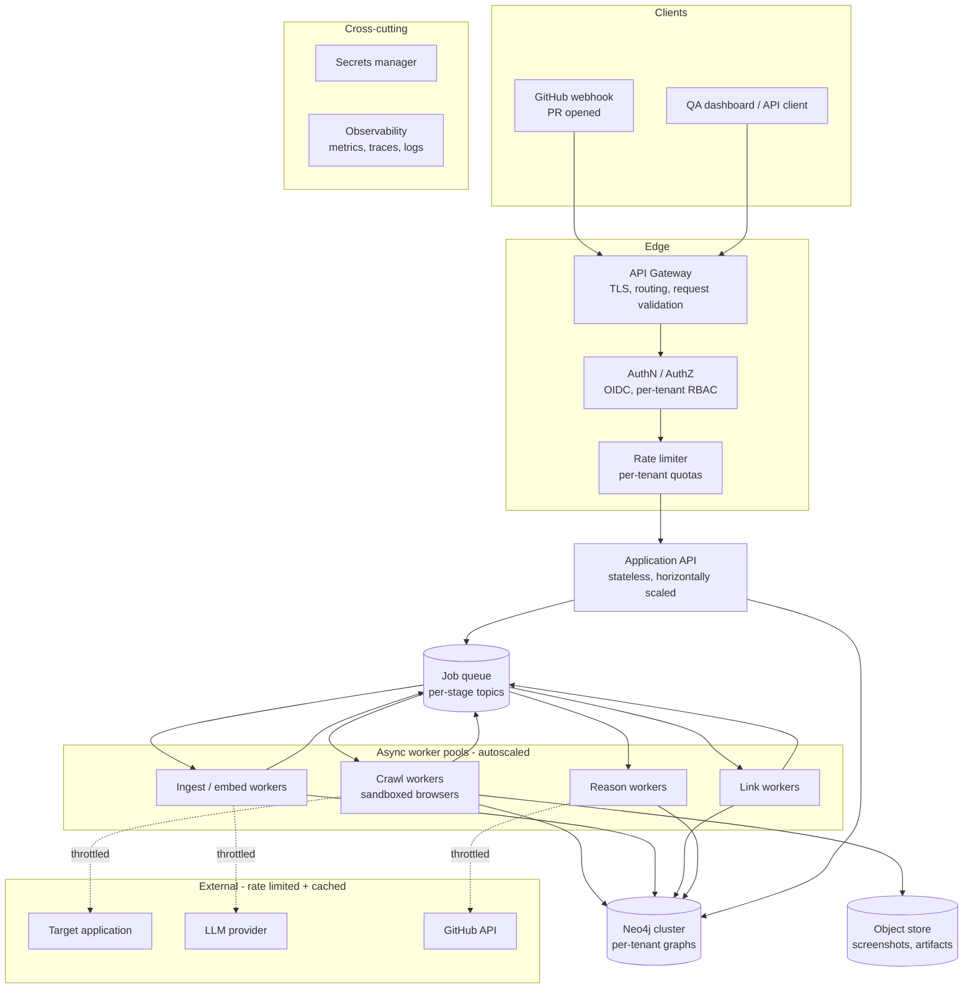

# Production Architecture (designed, not wired)

The prototype is a single-process local pipeline. This document is the high-level design for running it as a continuous service against many repositories and teams. **None of the components here are implemented in the 16-hour slice** — they are specified so the intended shape is clear, and so the "another week and beyond" path is concrete rather than hand-waved.

Everything the prototype does today maps onto one box in this diagram (the worker pool). The rest is the infrastructure that makes it safe, scalable, and multi-tenant.

---

## High-level design

---

## Why each piece exists

### API gateway
A single ingress for TLS termination, routing, request validation, and request-level quotas. A PR webhook and a dashboard query enter the same front door and are shaped before they reach application code.

### Authentication and authorization
- **AuthN:** OIDC for human users; signed webhook secrets for GitHub; short-lived service tokens between internal services.
- **AuthZ:** per-tenant RBAC. A tenant can only see its own graphs, artifacts, and reports. This is the single most important control, because the graph encodes a map of someone's product and code.
- **Isolation:** graphs and object storage are namespaced per tenant; no shared query surface across tenants.

### Rate limiters and backpressure
Three external dependencies can throttle or ban us, and the free-tier limits we hit in the prototype (100 embeddings per minute) make this concrete, not theoretical:
- the **target application** (crawling politely, with per-host concurrency caps and robots awareness),
- the **LLM provider** (token and request budgets per tenant), and
- the **GitHub API** (secondary rate limits).

Each has a limiter and a cache in front of it. Per-tenant quotas prevent one noisy tenant from exhausting a shared budget. Queues provide backpressure so a spike becomes a longer queue, not a cascade of failures.

### Asynchronous workers behind a queue
The expensive stages (crawl, embed, LLM) take seconds to minutes and are rate-limited. A PR webhook must return in milliseconds, so the work is enqueued and computed out of band. Stages are separate topics so they scale independently: crawl workers are browser-bound and few; link and reason workers are CPU- and LLM-bound and scale with load. Work is idempotent and retriable, which the prototype already respects (artifacts are versioned, graph load is reset-and-rebuild).

### Graph and artifact storage
- **Neo4j cluster**, per-tenant databases, for the knowledge graph.
- **Object store** for screenshots and large artifacts, referenced by URL from graph nodes rather than embedded.

### Observability
Metrics, traces, and structured logs on every stage and every external call. The confidence-calibration loop from the design doc's "another week" section feeds off this: record, per merged PR, whether flagged UI actually broke, and calibrate thresholds from outcomes.

---

## Security features

| Area | Control |
| --- | --- |
| Secrets | API keys and tokens in a managed secrets store, never in config or env files committed to the repo. The prototype keeps keys in a gitignored `.env`; production uses a secrets manager with rotation. |
| Least privilege | GitHub tokens scoped to read-only `public_repo` (or a GitHub App with minimal permissions); LLM keys per tenant with spend caps. |
| Crawler sandboxing | Browsers run in locked-down, ephemeral sandboxes with no access to internal networks; one compromised page cannot reach the platform. |
| Untrusted input | Everything fetched (DOM, docs, diffs) is treated as untrusted data, never as instructions; LLM prompts separate instructions from fetched content. |
| Tenant isolation | Per-tenant graphs, object-store prefixes, and quotas; authorization checked at the API, not only in the UI. |
| Transport and audit | TLS everywhere; audit log of who ran what against which repository. |
| Supply chain | Pinned dependencies (see `requirements.txt`); CI runs on every change. |

---

## What this means for the prototype

The prototype already makes the choices that let it slot into this design without rework:

- stages are **independent and idempotent**, so they become queue workers directly;
- artifacts are **versioned on disk**, so they become object-store blobs;
- the LLM sits behind **one swappable client**, so per-tenant budgets and provider failover attach in one place;
- the graph load is **reset-and-rebuild**, so it is safe to re-run;
- external calls are **already throttled and cached** (embeddings), so the limiter pattern is proven at small scale.

The gap from here to production is infrastructure and hardening, not a rewrite — which is the point of keeping the prototype honest about its boundaries.
